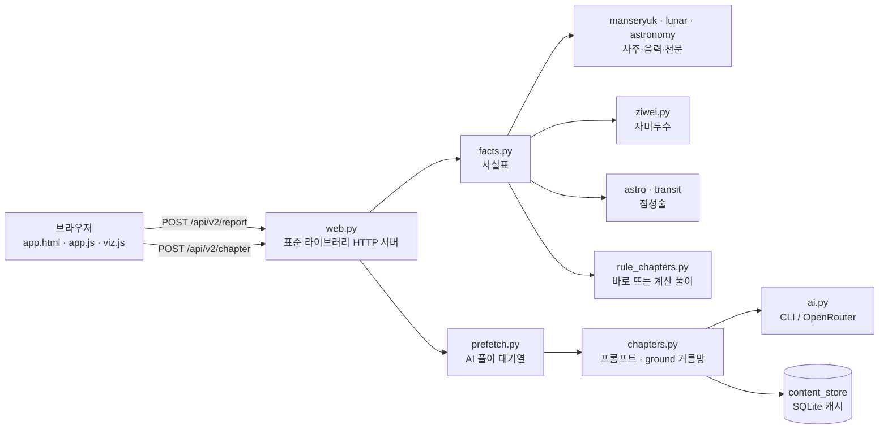

# 종합 사주 · saju-agent

사주, 자미두수, 서양 점성술을 **직접 계산하는 엔진**에, 계산 결과만 보고 풀이를 쓰는 **LLM 챕터 작성기**를 붙인 웹 서비스입니다.
AI는 계산된 사실표만 받고, 사실표에 없는 숫자나 단정하는 문장은 화면에 나가기 전에 걸러냅니다.

[](https://github.com/seungwook-kim/saju-agent/actions/workflows/ci.yml)


| 첫 화면 | 오늘 탭 | 평생 탭 (대운 x 원국) |
|---|---|---|
|  |  |  |

> 화면의 생년월일은 예시 값입니다.

## 무엇을 하나

- **정통 계산:** 네 기둥(사주), 대운, 신살, 자미두수 명반 12궁과 사화, 출생 차트(행성·상승궁·하우스), 오늘의 트랜짓, 택일(생기복덕·황도·건제)
- **탭 10개:** 총운 · 연애 · 직장 · 금전(오늘 하루) · 신년 · 평생 · 되짚기(지난 20년을 기억과 대조) · 궁합 · 길일 · 이름 풀이
- **바로 뜨는 풀이 + AI 풀이:** 입력 직후 계산 문장으로 모든 챕터를 채우고, AI 풀이가 준비되는 대로 챕터를 바꿔 끼웁니다.
- **개인정보:** 생년월일은 서버 메모리에만 잠깐 두고, 파일·로그·AI 요청에 넣지 않습니다. "이 기기에 기억하기"는 사용자가 켤 때만 브라우저에 저장합니다.

## 어려웠던 문제와 해결

### 1. 계산이 맞는지 어떻게 아나: 외부 기준값과 교차 검증
운세 계산은 틀려도 티가 안 납니다. 그래서 핵심 계산을 **독립된 구현이나 공공 자료와 맞대는 시험**으로 묶었습니다.

| 계산 | 대조한 기준 | 방식 |
|---|---|---|
| 네 기둥·12운성·택일 | [lunar-python](https://github.com/6tail/lunar-python) | 출생 240건, 일주 60개, 건제·황도 144건을 기준값 파일로 고정 (`tools/reference/`) |
| 자미두수 명반·사화·유년 | [iztro](https://github.com/SylarLong/iztro) | Node 스크립트로 명반 60개를 떠서 궁·별·사화 비교 |
| 음력 변환 | 한국천문연구원 음양력 자료 | 63건 대조 |
| 절기 시각 | NASA JPL DE421 천체력 | 생성 도구로 표를 만들고 앱은 표만 사용 |
| 균시차 | PyEphem | 날짜별 기준값 표 |

이 시험 덕분에 **태어난 시각 보정(균시차) 공식이 최대 29분 틀리던 버그**를 찾았습니다. 서로 다른 두 공식의 상수를 섞어 쓴 게 원인이었고, 고친 뒤 기준값과의 차이가 1분 안으로 들어왔습니다. 시주가 바뀔 수 있는 크기의 오차였습니다.

### 2. LLM이 지어내지 못하게: 사실표와 거름망
- `facts.py`가 계산 결과를 개인정보 없는 **사실표(JSON)**로 만들고, 챕터마다 필요한 부분만 골라 AI에 보냅니다.
- `chapters.ground()`는 AI가 쓴 문장 중 **사실표에 없는 숫자**("3개월 안에", "35세에")나 **단정 표현**이 든 문장을 빼는 마지막 거름망입니다. 저장된 풀이에도 읽을 때마다 다시 적용합니다.
- 프롬프트를 바꾸면 `PROMPT_VERSION`을 올려서, 저장소(SQLite)에 남은 예전 풀이를 자동으로 새로 만들게 했습니다.
- `prefetch.py`: 입력하자마자 모든 탭의 AI 풀이를 대기열에 넣고, 사용자가 연 탭을 맨 앞으로 당깁니다. 동시 호출 수를 제한하고 한 자리는 채팅용으로 남깁니다.
- `ai.py` 한 곳에서만 AI를 부르고, 구독 CLI와 OpenRouter API를 환경변수로 바꿔 끼웁니다.

### 3. 경계에서 흔들리는 입력 알려 주기
출생이 절기가 드는 순간이나 시가 바뀌는 경계와 몇 분 차이면, 기록이 조금만 틀려도 기둥이 바뀝니다.
`boundary.py`는 절입 3시간 안이나 시 경계 10분 안의 출생을 찾아 "월주가 A에서 B로 바뀔 수 있다"를 먼저 알려 줍니다.
무작위 2,000명 기준으로 시주 경계 13.8%, 월주 경계 1.4%가 해당했습니다.

### 4. 보안과 개인정보
- 서버는 생년월일을 저장하지 않고, 로그에도 입력값을 남기지 않습니다.
- 공유 링크는 계산 결과(사실표)만 저장합니다.
- 채팅의 "사용자 지정 LLM 주소" 기능은 요청에 담긴 주소로 서버가 대신 요청을 보내는 구조라 공개 서버에서 SSRF 통로가 됩니다. 그래서 기본으로 꺼 두고, `LOVE_FORTUNE_CUSTOM_LLM=1`일 때만 엽니다.

## 구조



| 폴더·파일 | 역할 |
|---|---|
| `love_fortune/` | 계산 엔진, 웹 서버, 풀이 생성 (파이썬 파일 44개) |
| `love_fortune/static/` | 화면 (바닐라 JS, 빌드 도구 없음) |
| `tests/` | 시험 578개. 외부 기준값 파일은 `tests/data/` |
| `tools/` | 기준값·데이터 생성 도구 (개발할 때만 외부 패키지 사용) |
| `db/` | 해석 데이터·AI 풀이 캐시의 SQLite 초기화 스크립트 |
| `docs/GUIDE.md` | 자세한 실행법, 운세 체계, 데이터 출처 |

**외부 패키지가 0개인 이유:** 계산 엔진을 오프라인에서도 결정적으로(같은 입력이면 항상 같은 결과) 돌리고, 배포를 단순하게 하려고 표준 라이브러리만 썼습니다. 천문 계산은 공개된 궤도 요소 공식을 직접 구현했고, 정확도가 필요한 절기 시각만 개발 단계에서 천체력으로 표를 만들어 넣었습니다.

## 실행

```bash
# 웹 (http://localhost:8765)
uv run python -m love_fortune form

# 시험·코드 검사
uv run --no-project --with pytest python -m pytest -q
uvx ruff check .
```

AI 풀이는 선택입니다. AI 없이도 모든 챕터가 계산 풀이로 채워집니다.

```bash
# OpenRouter로 AI 풀이 켜기
export LOVE_FORTUNE_AI_BACKEND=openrouter
export LOVE_FORTUNE_OPENROUTER_MODEL=<모델 이름>
export OPENROUTER_API_KEY=<키>
```

## 배포

- `Dockerfile`: 패키지 설치 없이 `python -m love_fortune form`으로 뜨고, `PORT`·`HOST` 환경변수를 따릅니다. `/healthz`로 상태를 확인합니다.
- `render.yaml`: [Render](https://render.com)에서 저장소를 연결하면 이 설정으로 무료 웹 서비스를 만듭니다. 방문자마다 AI 풀이를 미리 만들지 않도록 `LOVE_FORTUNE_PREFETCH=0`이 기본입니다.

## 개발 방식

AI 코딩 에이전트와 함께 개발했습니다. 에이전트가 지킬 규칙을 [`AGENTS.md`](AGENTS.md)에 적어 두었습니다: 개인정보 저장 금지, 결정적 계산, 단정 예언 금지, 외부 의존성 금지, 변경마다 시험과 실제 서버 확인.
모든 변경은 시험으로 검증했고, 계산은 외부 기준값과 맞대서 확인했습니다.

## 데이터와 라이선스

사용한 데이터와 라이선스는 [`THIRD_PARTY_NOTICES.md`](THIRD_PARTY_NOTICES.md)에 있습니다. 참고한 사이트의 문장은 옮기지 않았고, 교차 확인한 사실(분류, 계산 규칙, 숫자표)만 사용했습니다.
운세 풀이는 재미와 참고용이며, 의학·법률·투자 판단을 대신하지 않습니다.
