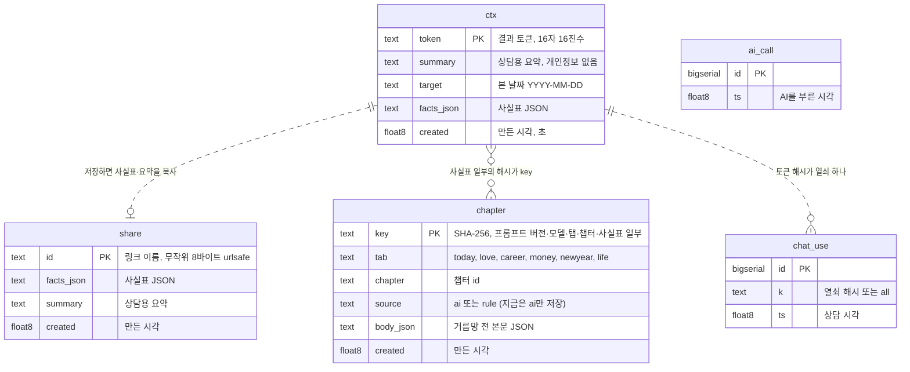
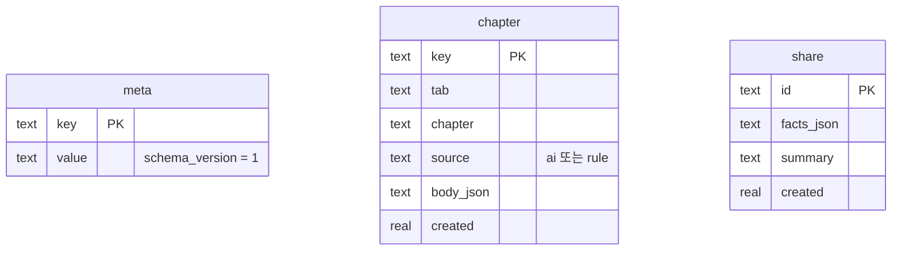
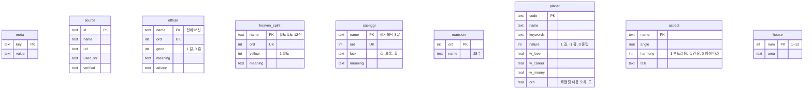

# ERD · 종합 사주 (saju-agent)

> 데이터 구조 문서. 무엇을 어디에, 얼마 동안, 어떤 열쇠로 두는지 적는다.
> 요구사항은 [PRD.md](PRD.md), 시스템 설계는 [SDD.md](SDD.md).
> 기준일: 2026-10-14. 표 정의의 원본은 `db/supabase.sql`, `db/content.sql`, `db/init.sql`이다.

## 1. 데이터가 있는 곳

| 곳 | 무엇 | 개인정보 | 원본 |
|---|---|---|---|
| Supabase (운영) | AI 챕터 풀이, 공유 결과, 결과 토큰, AI 호출 시각, 상담 사용 해시 | 없음 | `db/supabase.sql` |
| SQLite `data/content.db` (로컬) | AI 챕터 풀이, 공유 결과 | 없음 | `db/content.sql` |
| SQLite `data/fortune.db` | 해석 데이터 (택일, 생기복덕, 점성 트랜짓) | 없음 | `db/init.sql` |
| 내장 파이썬 표 | 음력표, 표준시 이력, 절기 시각, 토정비결 괘사, 인명용 한자 | 없음 | `tools/gen_*.py`로 생성 |
| 서버 메모리 | 결과 토큰과 사실표, 횟수, 대기열 | 입력값은 요청 처리 중에만 | `web.py`, `prefetch.py`, `ai.py` |
| 브라우저 | 기억한 사람, 성인 확인, `cid` 쿠키 | 기억한 사람은 있음 (사용자가 켰을 때, 그 브라우저에만) | `static/app.js` |

**지키는 규칙**: 생년월일, 태어난 시간, 성별 원문, 도시, 이름은 서버의 어떤 표에도 들어가지 않는다.
서버 표에 들어가는 것은 계산 결과(사실표), 상담용 요약, 해시뿐이다.

## 2. 운영 저장소 (Supabase)

점선은 외래 키가 아니라 **논리적 연결**이다. 표 사이에 외래 키 제약은 없다.

### 2.1 `chapter` · AI 챕터 풀이

| 컬럼 | 형 | 뜻 |
|---|---|---|
| `key` | text PK | `sha256(json({v: PROMPT_VERSION, model, tab, ch, facts: pick(사실표, 챕터 pick)}))` |
| `tab` | text | 탭 id |
| `chapter` | text | 챕터 id |
| `source` | text | `ai` 또는 `rule`. 계산 풀이는 저장하지 않으므로 실제로는 `ai`만 있다 |
| `body_json` | text | `{headline, lead, blocks[], closing}`. normalize 뒤, ground 전 본문 |
| `created` | double | 유닉스 시각(초) |

- 색인 `chapter_tab (tab, chapter)`.
- 같은 사실표 일부를 가진 사람끼리는 같은 줄을 함께 쓴다 (사람이 아니라 계산값으로 찾는다).
- 프롬프트 버전이나 모델이 바뀌면 key가 달라져 새 줄이 생긴다. 예전 줄은 지우지 않는다.
- 읽을 때마다 거름망(`chapters.ground`)을 다시 거친다.

### 2.2 `share` · 공유 결과

| 컬럼 | 형 | 뜻 |
|---|---|---|
| `id` | text PK | `secrets.token_urlsafe(8)`. 주소 `/r/<id>` |
| `facts_json` | text | 공유 당시 사실표 |
| `summary` | text | 상담용 요약 |
| `created` | double | 만든 시각 |

- 색인 `share_created (created)`. 기한 없이 남는다.
- 사주 원국(여덟 글자)이 들어 있어서 링크를 받은 사람은 원국을 볼 수 있다. 화면에 알린다.

### 2.3 `ctx` · 결과 토큰

| 컬럼 | 형 | 뜻 |
|---|---|---|
| `token` | text PK | `secrets.token_hex(8)` |
| `summary` | text | 상담용 요약 |
| `target` | text | 본 날짜 |
| `facts_json` | text | 사실표. 궁합(`/api/match`), 길일(`/api/pick`) 토큰은 비어 있다 |
| `created` | double | 만든 시각 |

- 색인 `ctx_created (created)`. 6시간 지나면 쓰지 않는다.
- 서버리스에서 요청마다 다른 기계가 받아도 탭과 상담이 이어지게 하려고 둔다. Supabase가 없으면 쓰지 않는다 (메모리만).

### 2.4 `ai_call` · AI 호출 시각

| 컬럼 | 형 | 뜻 |
|---|---|---|
| `id` | bigserial PK | |
| `ts` | double | 부른 시각 |

- 색인 `ai_call_ts (ts)`. 최근 1시간 줄 수로 시간당 상한(운영 300)을 센다.
- 상한이 있을 때만 적는다 (OpenRouter 방식). 로컬 CLI는 상한이 없어 적지 않는다.

### 2.5 `chat_use` · 상담 사용

| 컬럼 | 형 | 뜻 |
|---|---|---|
| `id` | bigserial PK | |
| `k` | text | `sha256(소금 + 열쇠)` 또는 전체 합계용 `all` |
| `ts` | double | 상담 시각 |

- 색인 `chat_use_k_ts (k, ts)`.
- 상담 한 번에 줄 다섯 개를 적는다: `ip:` (IPv6는 /64), `cid:` (쿠키), `t:` (결과 토큰), `s:` (원국과 성별의 해시), `all`.
- 소금은 서버 비밀(`SUPABASE_SECRET_KEY`)의 해시라서 서버 여러 대가 같은 값을 쓰고, 원래 IP나 쿠키 값은 되돌릴 수 없다.
- 최근 24시간 줄 수로 한 사람 5번, 전체 300번을 센다.

### 2.6 권한

- 다섯 표 모두 RLS를 켜고, `anon`, `authenticated`의 권한을 모두 회수했다. 허용 규칙이 없어서 공개 키로는 아무것도 못 읽는다.
- 앱 서버만 서버 전용 키로 REST를 부른다. 같은 key는 덮어쓴다 (`Prefer: resolution=merge-duplicates`).

## 3. 로컬 저장소 (`data/content.db`)

- Supabase가 없을 때(로컬, 시험) 쓴다. `chapter`, `share`는 Supabase와 컬럼이 같다.
- `ctx`, `ai_call`, `chat_use`는 SQLite에 없다. Supabase가 없으면 그 일은 서버 메모리가 맡는다.
- 지워도 된다. 다음에 필요할 때 `db/content.sql`로 다시 만든다.
- `tools/sync_supabase.py`는 Supabase의 다섯 표를 이 파일로 한 방향 복사한다 (DBeaver로 보기용, 복사 전 `content.db.bak` 백업).

## 4. 해석 데이터 (`data/fortune.db`)

계산 규칙은 코드에 있고, 이 DB에는 그 결과를 사람 말로 풀어 주는 데이터와 출처만 둔다.
`db/init.sql`의 `schema_version`이 바뀌면 다시 만든다. 앱은 처음 한 번 읽어 메모리에 들고 있는다.

| 표 | 줄 수 | 읽는 곳 |
|---|---|---|
| `meta` | 2 | `store.py` (버전 확인) |
| `source` | 7 | 출처와 검증 방법 기록 (앱은 읽지 않음) |
| `officer` | 12 | `today.py` |
| `heaven_spirit` | 12 | 참고용 (이름은 `almanac.py`가 직접 계산) |
| `saenggi` | 8 | `today.py` |
| `mansion` | 28 | 참고용 (이름은 `almanac.py`가 직접 계산) |
| `planet` | 7 | `transit.py` |
| `aspect` | 5 | `transit.py` |
| `house` | 12 | `transit.py` |

표 사이에 관계는 없다. 각 표가 독립된 조회표다.

## 5. 사실표 (facts_json)

`facts.build()`가 만드는 JSON이다. `ctx.facts_json`, `share.facts_json`에 그대로 들어가고, 챕터마다 일부(pick)만 AI에 간다.
생년, 생일, 도시, 태어난 시각 원문은 들어가지 않는다 (`tests/test_redesign.py`가 확인).

| 키 | 담는 것 | AI로 가나 |
|---|---|---|
| `meta` | 본 날짜, 성별, 만 나이, 세는나이, 시간을 아는지 | 늘 |
| `natal` | 일간, 네 기둥 풀이, 오행 개수, 십신, 신강약, 격국, 용신, 조후, 신살, 귀인, 대운, 자미두수 명반, 출생 차트 | 총운, 신년, 평생 탭 (챕터 pick에 따라) |
| `today` | 세 체계 신호와 합의, 택일, 영역 점수, 영역별 근거와 팁 | 오늘 탭 |
| `love`, `career`, `money` | 영역별 타고난 결(배우자 자리, 관록궁, 재백궁 등), 12개월, 3년, 좋은 달 | 평생 탭. 연애 탭 "오늘 이렇게 해 봐"도 배우자 자리, 금성, 만남 자리를 곁들인다 |
| `life` | 연대, 대운 흐름 | 평생 탭 |
| `newyear` | 세운, 토정비결, 열두 달, 자미 유년, 목성·토성 | 신년 탭 |
| `past` | 지난 해들의 신호 (되짚기) | 아니오 (계산 탭) |
| `insights` | 세 체계 합의도, 연애 골든타임 | 아니오 |
| `sok` | 속궁합 출생 쪽 값 | 아니오 (성인 확인 화면만) |

## 6. 브라우저 저장

| 키 | 곳 | 담는 것 | 언제 |
|---|---|---|---|
| `saju.people` | localStorage | `[{nick, q:{birth, leap, calendar, birth_time, unknown_time, sex, city, zi}}]`, 최대 6명 | '이 기기에 기억하기'를 켰을 때 |
| `saju.people.lock` | localStorage | `{v:1, salt, iv, ct}` PIN으로 암호화한 목록 (PBKDF2 20만 번, AES-GCM 256) | PIN 잠금을 켰을 때. 이때 `saju.people` 키는 지운다 |
| `saju.adult` | localStorage | `'1'` | 성인 확인을 켰을 때 |
| `saju.recent` | localStorage | 예전 버전의 키. 열 때 지운다 | |
| `cid` | 쿠키 (HttpOnly, SameSite=Strict, 30일) | 무작위 값 | 서버가 상담 횟수를 셀 때 |

sessionStorage는 쓰지 않는다. 이름표, 기억 칸, PIN은 서버로 보내지 않는다.
상담 대화는 화면 메모리(`S.chat`)에만 있고, 상담사 답마다 서버가 준 서명(`sig`)을 같이 들고 있다가 다음 질문 때 기록으로 보낸다.

## 7. 서버 메모리

| 이름 | 담는 것 | 수명, 크기 |
|---|---|---|
| `web._CONTEXTS` | 토큰 → 요약, 날짜, 사실표 | 6시간, 300개 넘으면 오래된 것부터 |
| `web._HITS` | IP별 최근 1분 요청 시각 | 5,000개 넘으면 정리 |
| `web._CHAT_USED` | 열쇠별 최근 24시간 상담 시각 (Supabase가 없을 때) | 20,000개 넘으면 정리 |
| `web._SALT` | 해시 소금 | 서버 비밀이 없으면 켤 때마다 새로 |
| `web._SIG_KEY` | 상담사 답 서명 열쇠 (소금에서 만듦) | 소금과 같음 |
| `prefetch._jobs`, `_heap` | 챕터 미리 만들기 작업과 결과 | 끝난 뒤 30분 |
| `ai._CALLS` | 최근 1시간 AI 호출 시각 (Supabase가 없을 때) | 1시간 |

입력값(생년월일 등)은 요청을 처리하는 함수 안에서만 쓰고 위 어디에도 남기지 않는다.

## 8. 수명과 정리

| 데이터 | 수명 | 정리 방법 |
|---|---|---|
| `chapter` | 기한 없음 | 프롬프트 버전, 모델이 바뀌면 새 key로 다시 만든다 (예전 줄은 남음) |
| `share` | 기한 없음 | 없음 |
| `ctx` | 6시간 | 읽을 때 6시간 지난 것은 무시. 저장할 때 2% 확률로 6시간 지난 줄 삭제 |
| `ai_call` | 1시간 셈, 24시간 보관 | 저장할 때 1% 확률로 24시간 지난 줄 삭제 |
| `chat_use` | 24시간 | 저장할 때 1% 확률로 24시간 지난 줄 삭제 |
| `content.db` | 기한 없음 | 지워도 다시 만든다 |
| `fortune.db` | `schema_version`까지 | 버전이 바뀌면 다시 만든다 |
| 브라우저 저장 | 사용자가 지울 때까지 | 화면의 지우기, PIN 잊음(전부 지움) |
| `cid` 쿠키 | 30일 | 브라우저 |
