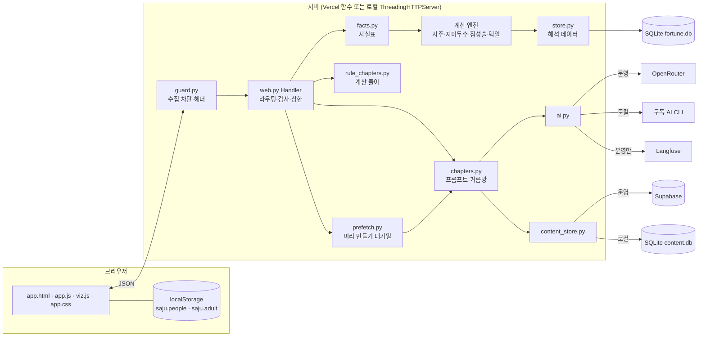
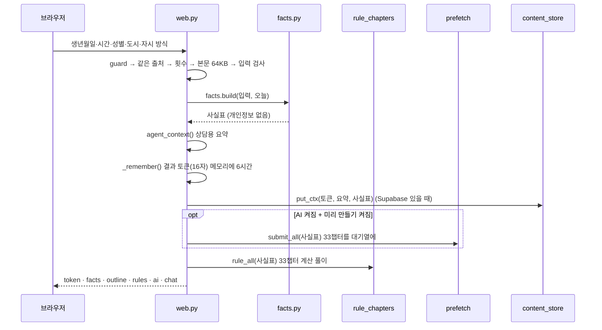
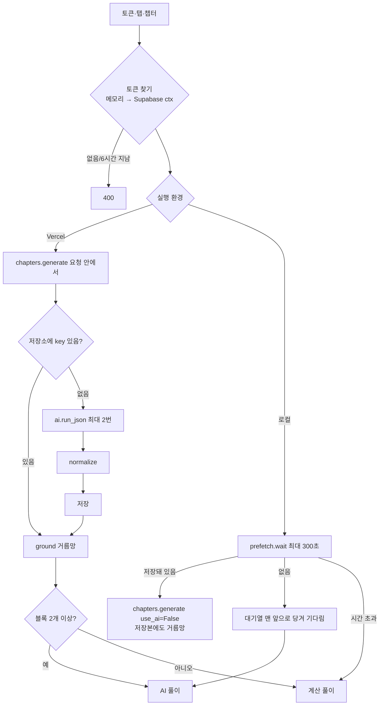
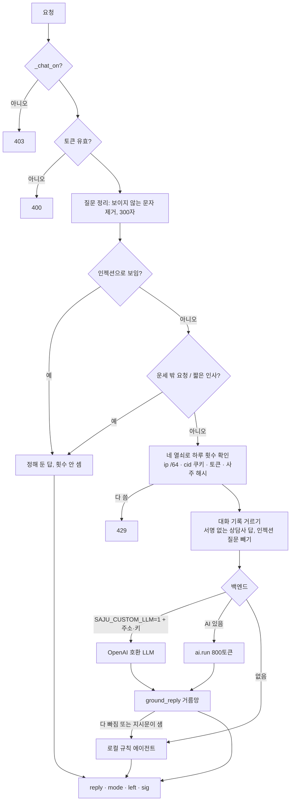

# SDD · 종합 사주 (saju-agent)

> 소프트웨어 설계 문서. 시스템이 어떻게 나뉘고, 요청이 어떻게 흐르고, 무엇을 어디에 두는지 적는다.
> 요구사항은 [PRD.md](PRD.md), 데이터 구조는 [ERD.md](ERD.md), 실행법은 [GUIDE.md](GUIDE.md).
> 기준일: 2026-10-14. 코드 위치는 `파일:줄`로 적었고, 코드가 바뀌면 줄 번호는 어긋날 수 있다.

## 1. 설계 원칙

| 원칙 | 설계에 드러나는 곳 |
|---|---|
| 표준 라이브러리만 | HTTP 서버(`http.server`), SQLite(`sqlite3`), 외부 API 호출(`urllib`)을 모두 직접 쓴다. 실행에 설치할 패키지가 없다. |
| 계산은 서버에만 | 계산 로직은 브라우저로 보내지 않는다. 화면은 JSON 결과만 그린다. |
| 개인정보는 메모리에만 | 입력값은 요청을 처리하는 동안만 쓰고, 저장하는 것은 개인정보 없는 사실표, 요약, 해시뿐이다. |
| AI는 한 곳에서만 | 모든 AI 호출은 `ai.py`를 지난다. 상한, 기록(Langfuse), 백엔드 교체가 한 곳에 모인다. |
| 늘 대신할 길이 있다 | AI 실패 → 계산 풀이, Supabase 실패 → 새로 만들거나 메모리로 세기, 상담 AI 실패 → 로컬 규칙 에이전트. |
| 결정적 | `random`을 쓰지 않는다. 고르는 일은 SHA-256 해시로 한다. |

## 2. 시스템 구성

### 실행 환경 두 가지

| | 운영 (Vercel) | 로컬 |
|---|---|---|
| 입구 | `love_fortune.wsgi:app` (`pyproject.toml` `[tool.vercel]`) | `python -m love_fortune form` (`cli.py`) |
| HTTP | WSGI 어댑터가 요청을 원래 HTTP 바이트로 다시 만들어 `web.Handler`에 그대로 넘긴다 (`wsgi.py:38-70`) | `ThreadingHTTPServer` + `web.Handler` |
| 챕터 AI | 요청 안에서 바로 만든다 (`SERVERLESS`, `web.py:739`) | `prefetch` 대기열에서 미리 만들고 화면 요청을 앞으로 당긴다 |
| AI 백엔드 | OpenRouter (`SAJU_AI_BACKEND=openrouter`) | 구독 AI CLI (`claude -p …`) |
| 저장소 | Supabase REST | SQLite `data/content.db` |
| 결과 토큰 | 메모리 + Supabase `ctx` (요청마다 다른 기계가 받아도 이어지게) | 메모리 |
| 임시 파일 | `/tmp` (`VERCEL` 값이 있으면) | `data/` |
| 횟수 제한 | 기계마다 메모리로 세서 느슨함. 돈은 `ai_call` 총량이 막는다 | 메모리 |
| AI 기록 | Langfuse (동기 전송) | 기록하지 않음 (키를 주석 처리) |

## 3. 모듈 구성

`love_fortune/` 아래 파이썬 파일 52개. 층별로 나누면 이렇다.

| 층 | 모듈 | 하는 일 |
|---|---|---|
| 입구 | `__init__`, `__main__`, `cli`, `web`, `wsgi`, `dotenv`, `guard` | 실행, HTTP 라우팅, Vercel 어댑터, `.env` 읽기, 수집 차단 |
| 달력·천문 | `lunar`, `calendar_data`*, `solar_terms_data`*, `astronomy` | 음력 변환, 표준시·서머타임 이력, 진태양시, 절기 시각표, 행성 위치 |
| 사주 | `manseryuk`, `rules`, `yongsin`, `johu`, `natal_extra`, `dayun_rel`, `boundary`, `signals` | 네 기둥, 대운, 신살, 합충형파해, 십신, 신강약·격국·용신, 조후, 경계 출생 알림, 좋은 달·해 |
| 자미두수 | `ziwei` | 명반 12궁, 사화, 대한, 유년, 유월, 유일 |
| 점성술 | `astro`, `transit` | 출생 차트(Whole Sign 하우스, 각도, 역행), 오늘 트랜짓 |
| 택일 | `almanac`, `taekil`, `tojeong`, `tojeong_data`* | 생기복덕·건제·황도흑도, 길일 고르기, 토정비결 |
| 종합 | `synthesis`, `today`, `domains`, `lifetime`, `newyear`, `past`, `insights`, `match`, `matchmaking`, `sok`, `rectify`, `naming` | 오늘 세 체계 종합, 영역 점수, 평생·신년·되짚기, 세 체계 합의도·골든타임, 궁합, 속궁합, 시간 찾기, 이름 풀이 |
| 풀이 | `facts`, `rule_chapters`, `chapters`, `narrate`, `story`, `glossary`, `josa`, `advise` | 사실표, 계산 풀이, 챕터 설계·AI 프롬프트·거름망, 서사 문장, 용어집, 조사 고르기, 행운 요소 |
| AI·저장 | `ai`, `prefetch`, `content_store`, `store`, `langfuse`, `injection` | AI 호출, 미리 만들기, 풀이·공유·토큰 저장, 해석 데이터 DB, AI 기록, 프롬프트 인젝션 막기 |

`*` 표시는 도구(`tools/gen_*.py`)로 만든 자동 생성 파일이다. 손으로 고치지 않는다.

## 4. 주요 흐름

### 4.1 결과 보기 (`POST /api/v2/report`)

- 사실표 맨 위 키: `meta`, `natal`, `today`, `love`, `career`, `money`, `life`, `past`, `insights`, `sok`, `newyear` (`facts.py:127-237`). 자세한 구조는 [ERD.md](ERD.md#5-사실표-facts_json).
- 계산 풀이는 저장하지 않는다. 다음에 AI로 다시 시도하기 위해서다.

### 4.2 챕터 AI 풀이 (`POST /api/v2/chapter`)

- **저장 key** = SHA-256(`{v: PROMPT_VERSION, model, tab, ch, facts: pick(사실표, 챕터의 pick)}`) (`chapters.py:215-218`). 프롬프트 버전(지금 `ch-9`)이나 모델을 바꾸면 key가 바뀌어 저장본을 새로 만든다.
- **pick**: 챕터마다 사실표에서 필요한 경로만 골라 AI에 보낸다. `meta`는 늘 들어간다. `sok`, `insights`는 어떤 챕터의 pick에도 없어서 AI로 가지 않는다.
- **normalize** (`chapters.py:377-400`): 블록 종류 6개(text, quote, checklist, steps, cards, callout)만 남기고, 체크리스트 8개·단계/카드 6개·블록 8개·제목 60자로 자른다. text 블록이 없으면 실패.
- **_clean** (`chapters.py:227-237`): em dash는 쉼표로, 한자·가나·이모지는 지우고, %·퍼센트·확률이 든 문장은 뺀다.
- **ground** (`chapters.py:343-374`): 사실표에 없는 숫자, 나이(살·세), 개월 수, 확정 표현(`_SURE`, 단 "반드시 조심" 같은 `_SURE_OK`는 허용), 사실표에 없는 전문 이름(`DOMAIN_TERMS`: 별, 궁, 십신, 신살, 12운성, 별자리, 행성)이 든 문장을 뺀다. 저장된 것을 읽을 때마다 다시 적용한다.
- **저장 시점**: normalize 뒤, ground 전의 본문을 저장한다. 거름망 규칙이 바뀌면 저장본에도 새 규칙이 적용된다.

### 4.3 미리 만들기 (`prefetch.py`, 로컬)

- 우선순위 힙. `submit_all` 우선순위 = 탭 순번 × 100 + 챕터 순번, 화면이 지금 연 챕터는 `URGENT(-1)`로 당긴다.
- 같은 key는 한 번만 만든다. 끝난 작업은 30분 들고 있는다.
- 일꾼 수 = `max(1, SAJU_AI_PARALLEL - 1)`. 한 자리는 상담용으로 남긴다.
- 새 사람 한 명당 AI 호출이 최대 33번 생겨서 공개 서버(Dockerfile)는 `SAJU_PREFETCH=0`이 기본이다. Vercel은 요청 안에서 만들기 때문에 대기열을 쓰지 않는다.

### 4.4 상담 (`POST /api/chat`)

- 횟수: 한 사람 하루 10번(`SAJU_CHAT_PER_DAY`), 모두 합쳐 하루 300번(`SAJU_CHAT_GLOBAL_PER_DAY`).
- 열쇠는 서버 비밀에서 만든 소금을 섞어 SHA-256으로 해시해서 Supabase `chat_use`에 적는다. 원래 IP, 쿠키 값은 남지 않는다. Supabase가 없거나 실패하면 기계 메모리로 센다.
- 루프백 접속(프록시 신뢰가 꺼진 로컬)은 세지 않는다.
- `cid` 쿠키: 16바이트 무작위, HttpOnly, SameSite=Strict, 30일, 프록시 뒤면 Secure.
- 상담 AI에 보내는 것: 개인정보 없는 요약(`agent_context`), 최근 대화 10개, 질문.

#### 프롬프트 인젝션 막기 (`injection.py`)

사용자가 친 글이 AI까지 가는 길은 상담 채팅 하나뿐이다 (챕터 풀이는 계산한 사실표만 보낸다). 그 길을 여러 겹으로 막는다.

| 겹 | 하는 일 |
|---|---|
| 정리 `clean` | 보이지 않는 문자(폭 없는 공백, 방향 바꾸기 문자 등)와 제어 문자를 지우고 300자로 자른다. NFKC는 낱자 자모(ㅋ, ㅎ)를 바꿔 버려서 정리에는 쓰지 않는다. |
| 알아보기 `looks_like` | 규칙 무시, 역할 바꾸기, 지시문 공개 요청, 가짜 역할 꼬리표(`</질문>`, `상담사:`, `[SYSTEM]`, `<\|im_start\|>`)를 찾으면 AI 없이 `INJECTION_REPLY`로 답한다 (횟수에 안 셈). 전각 글자, 닮은 키릴·그리스 글자, 글자 사이 공백·점·보이지 않는 문자로 피해 가도 같은 글로 본다. 운세 질문을 잘못 막지 않게 '앞의, 모든, 너의' 같은 꾸밈말이 붙은 경우만 잡는다. |
| 기록 거르기 `_clean_history` | 브라우저가 보낸 대화 기록에서 상담사 답은 서버가 서명한 것(`sig`, 결과 토큰에 묶인 HMAC)만 남긴다. 사용자 말은 새 질문과 똑같이 정리하고 인젝션·운세 밖이면 뺀다. |
| 가두기 `fence` | 사용자 글을 `<대화>`, `<질문>` 울타리 안에 한 줄로 넣고 꺾쇠를 괄호로 바꾼다. 줄바꿈으로 가짜 '상담사:' 줄을 만들거나 울타리를 닫을 수 없다. 시스템 지시문 11번 규칙이 울타리 안 글을 자료로만 다루게 한다. |
| 새는지 보기 `leaks` | 답에 시스템 지시문의 글자 24개가 연달아 그대로 있으면 그 답을 버리고 계산 결과 답으로 바꾼다. |
| 거름망 `ground_reply` | 원래 있던 거름망. 요약에 없는 숫자, 용어, 확정 예언을 뺀다. |

## 5. API 명세

모든 POST는 이 순서로 검사한다: 경로 확인(404) → 수집 차단(403) → 같은 출처(403) → 횟수(429) → 본문 64,000바이트와 형식(400) → 처리(입력 오류 400, 그 밖 500, 오류 종류만 stderr에).

### GET

| 경로 | 돌려주는 것 | 비고 |
|---|---|---|
| `/`, `/r/<id>` | `app.html` | `<id>`는 `[A-Za-z0-9_-]{8,16}`. 공유 결과는 화면이 `/api/v2/shared`로 불러온다. |
| `/static/<이름>` | app.html, app.css, app.js, viz.js만 | `Cache-Control: no-cache` |
| `/healthz` | `{ok, store: supabase\|sqlite}` | 수집 차단 예외 |
| `/api/whoami` | `{ip}` | 프록시 뒤 IP 설정 확인용 |
| `/api/lunar-year?y=` | `{year, months:[{m, leap, days}]}` | 1900~2049 밖이면 400 |
| `/api/name/hanja?r=&s=1` | `{r, items}` (한자는 코드포인트) | 한 음절 한글이 아니면 400 |
| `/api/glossary` | 용어 풀이 사전 | |
| `/robots.txt`, `/llms.txt`, `/ai.txt`, `/.well-known/tdmrep.json` | 수집 금지 안내 | 수집 차단 예외 |

### POST

| 경로 | 받는 것 | 돌려주는 것 |
|---|---|---|
| `/api/v2/report` | 사람 입력 | `token, facts, outline, rules, ai, chat` |
| `/api/v2/chapter` | `token, tab, chapter` | `headline, lead, blocks, closing, source(ai\|rule)` |
| `/api/v2/share` | `token` | `id, path(/r/<id>)` |
| `/api/v2/shared` | `id` | report와 같은 모양 + `shared: true` |
| `/api/v2/rectify` | 사람 입력 + `events[]` | 12시진 후보 점수 |
| `/api/match` | 두 사람 입력 (뒤 사람은 `2` 붙인 이름) | `token, data{score, head, story, strengths, cautions, a, b, dates, sok}` |
| `/api/pick` | 사람 입력 + `from_date, to_date, domain` | `token, data{start, end, domain, story, rows}` |
| `/api/name` | `surname, given, hanja[≤5], token?` | 이름 풀이 결과 |
| `/api/chat` | `token, message, history[{role, content, sig}]` (+ `backend, endpoint, api_key, model`) | `reply, mode, model, left, sig` |

**사람 입력**: `birth`(YYYY-MM-DD), `calendar`(solar\|lunar), `leap`, `birth_time`(HH:MM, 기본 12:00), `unknown_time`, `sex`(기본 male), `city`(기본 서울, 40자), `zi`(next\|split).

HEAD, OPTIONS는 구현하지 않아 501이 나간다.

## 6. AI 호출 (`ai.py`)

| 항목 | CLI (로컬) | OpenRouter (운영) |
|---|---|---|
| 호출 | `claude -p --model … --output-format json --system-prompt-file <임시> --tools "" --no-session-persistence --strict-mcp-config`, 표준입력으로 요청, 임시 폴더에서 실행 | `chat/completions` HTTPS |
| 모델 | `SAJU_AI_MODEL` (기본 claude-sonnet-5) | `SAJU_OPENROUTER_MODEL` (운영 `qwen/qwen3.7-flash`) |
| 생각 | 해당 없음 | 끔 (`reasoning.enabled=false`) |
| 제공사 | 해당 없음 | 가격순 (`provider.sort=price`) |
| JSON | 응답에서 가장 바깥 `{…}`를 꺼낸다 | `response_format: json_object` |
| 시간당 상한 | 없음 (0) | 300번, 부르기 전에 센다 (실패도 센다) |
| 쓸 수 있나 | `claude` 명령이 있으면 | 키와 모델이 둘 다 있으면 |

- 시간 제한 180초, 동시 호출 3개(`BoundedSemaphore`), 챕터 답 2,000토큰, 상담 답 800토큰.
- 시간당 총량은 Supabase `ai_call`로 서버 여러 대가 함께 센다. 없으면 기계 메모리.
- 부를 때마다 `langfuse.log_generation`이 이름(chapter/chat), 모델, 입력과 출력, 토큰 수, 비용, 오류를 보낸다. `SAJU_LANGFUSE_CONTENT=0`이면 숫자만 보낸다. 키가 없으면 아무것도 안 한다.

## 7. 저장소

| 저장소 | 무엇을 | 언제 쓰나 |
|---|---|---|
| Supabase (REST) | `chapter`, `share`, `ctx`, `ai_call`, `chat_use` | `SUPABASE_URL`과 `SUPABASE_SECRET_KEY`가 있으면 (운영) |
| SQLite `data/content.db` | `meta`, `chapter`, `share` | Supabase가 없으면 (로컬, 시험) |
| SQLite `data/fortune.db` | 해석 데이터 9개 표 | 늘. `db/init.sql`로 처음 실행 때 만들고, 버전이 바뀌면 다시 만든다. 한 번 읽어 메모리에 둔다. |
| 서버 메모리 | 결과 토큰, 횟수, 대기열 | 늘 |
| 브라우저 | 기억한 사람, 성인 확인, `cid` 쿠키 | 사용자가 켰을 때 |

표와 컬럼, 수명은 [ERD.md](ERD.md)에 있다. Supabase 표는 RLS를 켜고 공개 키 권한을 모두 회수해서, 서버 전용 키로만 읽고 쓴다.

## 8. 보안과 개인정보

| 위협 | 막는 방법 | 위치 |
|---|---|---|
| 생년월일 유출 | 저장, 로그, AI 요청에 넣지 않음. 사실표에 생년, 생일, 도시, 시간이 없는지 시험으로 확인 | `facts.py`, `tests/test_redesign.py` |
| AI 수집·스크랩 | 수집 도구 UA 403 (빈 UA 포함, 카카오톡·슬랙 등 링크 미리보기는 허용), noai 헤더, 안내 파일 | `guard.py` |
| 다른 사이트에서 POST | Origin이 Host(또는 신뢰하는 X-Forwarded-Host, `SAJU_ORIGINS`)와 다르면 403. `Origin: null`도 403 | `web.py:901-914` |
| 요청 폭주 | IP당 POST 1분 90번, 상담 12번 | `web.py:43-46, 127-143` |
| AI 요금 폭탄 | 시간당 300번, 상담 하루 10번·전체 300번, 질문 300자, 답 길이 상한 | `ai.py`, `web.py` |
| AI를 다른 용도로 | 챕터 요청에는 사용자가 친 글자가 없다. 상담은 운세 밖 요청을 AI 없이 돌려보낸다 | `chapters.py`, `web.offtopic` |
| 프롬프트 인젝션 | 정리, 알아보기, 서명한 기록만 믿기, 울타리, 지시문 샘 검사 (4.4절) | `injection.py`, `web._chat` |
| SSRF | 사용자 지정 LLM 주소는 `SAJU_CUSTOM_LLM=1`일 때만, http/https만 | `web.py:1152-1159, 603-634` |
| IP 꾸미기 | X-Forwarded-For 맨 왼쪽이 아니라 오른쪽에서 `SAJU_PROXY_HOPS`번째, 또는 `SAJU_IP_HEADER` | `web.py:931-945` |
| 키 유출 | 서버 전용 키는 환경변수에만, 화면·저장소·로그에 넣지 않음. `.env`는 git과 배포에서 뺀다 | `.gitignore`, `.vercelignore` |
| 내용 노출 | 모든 응답에 `X-Content-Type-Options: nosniff` | `guard.py` |

## 9. 설정 (환경변수)

| 영역 | 이름 | 기본 | 뜻 |
|---|---|---|---|
| 읽기 | `SAJU_DOTENV` | 1 | 0이면 `.env`를 읽지 않음 (시험). 이미 있는 환경변수는 덮어쓰지 않음 |
| 서버 | `PORT`, `HOST` | 8765, 127.0.0.1 | |
| 서버 | `SAJU_OPEN_BROWSER` | 꺼짐 | 1이면 브라우저를 엶 |
| 서버 | `VERCEL` | (Vercel이 줌) | 서버리스 모드, `/tmp`, Langfuse 동기 전송 |
| 지킴 | `SAJU_BOT_BLOCK` | 1 | 0이면 수집 차단 끔 |
| 지킴 | `SAJU_RATE` | 1 | 0이면 횟수 제한 끔 (시험) |
| 지킴 | `SAJU_ORIGINS` | 없음 | 따로 허용할 Origin 호스트 |
| 지킴 | `SAJU_TRUST_PROXY` | 없음 | 프록시 헤더 믿기, Secure 쿠키, 상담 auto 끔 |
| 지킴 | `SAJU_IP_HEADER`, `SAJU_PROXY_HOPS` | 없음, 1 | 방문자 IP 읽는 법 |
| 상담 | `SAJU_CHAT` | auto | auto 루프백만, 1 어디서나, 0 막음 |
| 상담 | `SAJU_CHAT_PER_DAY`, `SAJU_CHAT_GLOBAL_PER_DAY` | 10, 300 | |
| 상담 | `SAJU_CUSTOM_LLM` | 0 | 1이면 사용자 지정 LLM 주소 허용 |
| AI | `SAJU_AI` | 1 | 0이면 계산 풀이만 |
| AI | `SAJU_PREFETCH` | 1 | 0이면 연 탭만 만듦 |
| AI | `SAJU_AI_BACKEND` | cli | cli 또는 openrouter |
| AI | `SAJU_AI_CLI`, `SAJU_AI_MODEL` | claude, claude-sonnet-5 | CLI 방식 |
| AI | `OPENROUTER_API_KEY`, `SAJU_OPENROUTER_MODEL`, `SAJU_OPENROUTER_URL` | 없음 | OpenRouter 방식 |
| AI | `SAJU_OPENROUTER_REASONING`, `SAJU_OPENROUTER_SORT`, `SAJU_APP_NAME` | off, price, saju-agent | |
| AI | `SAJU_AI_PARALLEL`, `SAJU_AI_PER_HOUR`, `SAJU_AI_MAX_TOKENS` | 3, (openrouter 300 / cli 0), 2000 | |
| 저장 | `SUPABASE_URL`, `SUPABASE_SECRET_KEY` (또는 `SUPABASE_SERVICE_ROLE_KEY`) | 없음 | 있으면 Supabase. 키는 상담 해시 소금의 재료도 됨 |
| 저장 | `SAJU_CONTENT_DB`, `SAJU_DB` | `data/`(Vercel은 `/tmp`) | SQLite 파일 위치 |
| 기록 | `LANGFUSE_PUBLIC_KEY`, `LANGFUSE_SECRET_KEY`, `LANGFUSE_HOST` | 없음, 없음, cloud.langfuse.com | 둘 다 있으면 기록 |
| 기록 | `SAJU_LANGFUSE_CONTENT` | 1 | 0이면 숫자만 보냄 |

운영(Vercel Production)에 넣어 둔 이름: `SAJU_AI_BACKEND`, `SAJU_OPENROUTER_MODEL`, `OPENROUTER_API_KEY`, `SAJU_AI_PER_HOUR`, `SAJU_PREFETCH`, `SAJU_CHAT`, `SAJU_TRUST_PROXY`, `SAJU_IP_HEADER`, `SUPABASE_URL`, `SUPABASE_SECRET_KEY`, `LANGFUSE_HOST`, `LANGFUSE_PUBLIC_KEY`, `LANGFUSE_SECRET_KEY`.

## 10. 배포와 운영

### Vercel
- 프로젝트 `saju-agent`, 서울 리전(`vercel.json` `regions: ["icn1"]`), 프레임워크 python.
- 입구 `love_fortune.wsgi:app`. 배포에 올리지 않는 것은 `.vercelignore`(`.env*`, `data`, `tests`, `tools`, `docs`, `Dockerfile` 등).
- 배포는 Vercel CLI로 한다 (`vercel deploy --prod`). 운영 주소 `https://saju-agent-nine.vercel.app`.
- 무료(Hobby) 플랜은 요청 기록을 1시간쯤만 남긴다. 지난 오류는 Langfuse와 Supabase 흔적으로 본다.
- Hobby 플랜은 비상업 용도만 된다. 광고나 유료 기능을 붙이면 Pro로 올려야 한다.

### Supabase
- 표는 `db/supabase.sql`로 한 번 만든다 (여러 번 돌려도 됨).
- 무료 프로젝트는 7일 동안 요청이 없으면 멈춘다. 멈추면 대시보드에서 다시 켠다.
- 쌓인 데이터를 DBeaver로 보려면 `tools/sync_supabase.py`로 `data/content.db`에 한 방향 복사한다.

### 그 밖
- `Dockerfile`: 설치 없이 `python -m love_fortune form`으로 뜬다 (`HOST=0.0.0.0`, `PORT=8765`, `SAJU_PREFETCH=0`, `/healthz` 상태 확인). 지금 운영에는 쓰지 않는다.
- 로컬 서버는 사용자가 켜 달라고 할 때만 켠다. 자동으로 다시 켜는 감시 스크립트는 없다.

## 11. 관측

| 무엇 | 어디 | 비고 |
|---|---|---|
| 서버 살아 있음 | `/healthz` | 저장소 종류도 함께 |
| AI 호출, 오류, 시간, 비용 | Langfuse | 운영만 기록 |
| 사용량 흔적 | Supabase `chapter.created`, `ctx.created`, `ai_call.ts`, `chat_use.ts` | 로컬과 운영이 같은 Supabase를 쓰면 섞인다 |
| 요청 기록 | Vercel 로그 | 1시간쯤만 남음 |
| 서버 오류 | stderr | 오류 종류만, 입력값과 키는 남기지 않음 |

## 12. 시험

- `tests/` 아래 33개 파일, 시험 705개 (2026-10-14). 실행: `uv run --no-project --with pytest python -m pytest -q`.
- 시험은 AI 없이(`SAJU_AI=0`), `.env` 없이(`SAJU_DOTENV=0`), Supabase 키 없이 돈다 (`tests/conftest.py`).
- 외부 기준 대조:

| 계산 | 기준 | 시험 |
|---|---|---|
| 네 기둥, 12운성, 택일 | lunar-python | `test_saju_reference.py` |
| 음력, 절기 | 한국천문연구원, 공개 절기표 | `test_official_reference.py` |
| 자미두수 | iztro | `test_ziwei_iztro.py` |
| 균시차, 행성 | PyEphem | 기준값 표 (`tests/data/`) |

- 서버 시험은 `tests`의 `server` 고정물로 실제 HTTP 서버를 띄워서 본다.
- 바꾼 뒤에는 시험 전체 통과, 예시 입력 실행, 실서버 화면 확인을 한다.

## 13. 알려진 한계

| 한계 | 영향 | 대응 |
|---|---|---|
| 서버리스에서 횟수 제한이 기계마다 따로 셈 | 1분 횟수 제한이 느슨함 | 돈은 Supabase `ai_call`, `chat_use` 총량으로 막는다 |
| 로컬 구독 AI CLI가 느림 | 2026-09-28~10-03 챕터 218번 중 17번이 180초 안에 답하지 못함 | 계산 풀이가 대신 남는다. 운영(OpenRouter)에는 없는 문제 |
| 오래된 Supabase 줄 정리가 확률적 | `ctx`(6시간), `ai_call`·`chat_use`(24시간)를 넘긴 줄이 잠시 남음 | 세는 쿼리는 시간 조건으로 거르므로 결과에는 영향 없음 |
| 로컬과 운영이 같은 Supabase | 사용량 흔적이 섞임 | 필요하면 로컬은 Supabase 키를 비우고 SQLite로 |
| 공유 링크에 원국이 보임 | 링크를 받은 사람이 여덟 글자를 봄 | 화면에 알리고, 생년월일과 도시는 넣지 않는다 |
